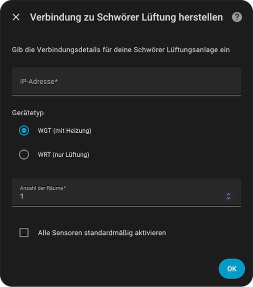
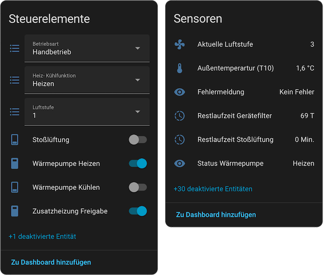
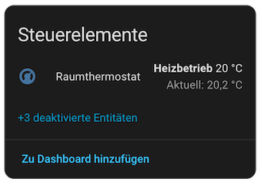

# Schwörer Lüftung Integration für Home Assistant

[English](README.md) | **Deutsch**

[](https://github.com/josa42/homeassistant-schwoerer-lueftung/releases)
[](LICENSE)
[](https://hacs.xyz/)

Eine Home-Assistant-Integration für Lüftungs- und Heizungsanlagen von [Schwörer](https://www.bauinfocenter.de/lueftung) über Modbus TCP.

> [!TIP]
> Dashboard-Karten für diese Integration gibt es in
> [homeassistant-schwoerer-lueftung-cards](https://github.com/josa42/homeassistant-schwoerer-lueftung-cards):
> ein Schema des Luftwegs durch die Anlage mit allen Temperaturfühlern an
> ihrem Platz und eine Ansicht pro Raum mit Ist- und Solltemperatur.

<br><br>

## Unterstützte Geräte

Die Integration unterstützt Schwörer-Lüftungsanlagen, die über Modbus TCP kommunizieren:

- **WGT (Wärmerückgewinnung mit Heizung)**: Lüftung mit Wärmerückgewinnung und Heizung
- **WRT (Wärmerückgewinnung)**: nur Lüftung mit Wärmerückgewinnung

Beide Gerätetypen lassen sich umfassend überwachen und steuern. WGT-Modelle können zusätzlich über die Wärmepumpe heizen und kühlen und die Temperatur in mehreren Räumen regeln.

<br><br>

## Funktionen

Die Integration steuert und überwacht deine Schwörer-Lüftungsanlage: mehrere Betriebsarten, Luftstufen und über 28 Sensoren zum Zustand der Anlage. WGT-Modelle bringen dazu die Raumregelung für bis zu 17 Räume mit, mit Heizen und Kühlen über die Wärmepumpe und einer Solltemperatur pro Raum.

<br><br>

## Installation

[](https://my.home-assistant.io/redirect/hacs_repository/?owner=josa42&repository=homeassistant-schwoerer-lueftung&category=integration)

### Voraussetzungen
- Home Assistant **2026.9.0** oder neuer
- Eine Schwörer-Lüftungsanlage mit Modbus TCP
- Eine Netzwerkverbindung zur Anlage

Die [manuelle Installation](docs/manual_installation.de.md) beschreibt, wie du
das Repository von Hand hinzufügst oder ohne HACS installierst.

<br><br>

## Konfiguration

### Integration hinzufügen

1. Öffne **Einstellungen** → **Geräte & Dienste**
2. Klicke auf **+ Integration hinzufügen**
3. Suche nach „Schwörer Lüftung“
4. Folge den Schritten der Einrichtung:



#### Einstellungen

| Einstellung                     | Beschreibung                                                  | Standard |
|---------------------------------|---------------------------------------------------------------|----------|
| **IP-Adresse**                  | IP-Adresse deiner Schwörer-Anlage                             | Pflicht  |
| **Gerätetyp**                   | WGT (mit Heizung) oder WRT (nur Lüftung)                      | WGT      |
| **Anzahl der Räume**            | Räume mit Raumregelung (1-17)                                 | 1        |
| **Hat Erdwärmetauscher (EWT)**  | Einschalten, wenn deine Anlage einen Erdwärmetauscher hat     | Aus      |

> [!TIP]
> Nach der Installation sind fast alle Entitäten aktiviert. Drei sind deaktiviert: die undokumentierte Temperatur T9, die Geräteuhr und der Binärsensor für die Zusatzheizung pro Raum, der denselben Wert zeigt wie der Schalter daneben. Du kannst jede davon auf ihrer eigenen Seite aktivieren.

<br><br>

## Entitäten

Welche Entitäten die Integration anlegt, hängt vom Gerätetyp ab. Die Namen sind die aus der deutschen Oberfläche von Home Assistant.

### Zentrale Entitäten

Steuerung und Überwachung der ganzen Anlage:



<br><br>

| Typ             | Entität                              | Beschreibung                                                   | Zustände                                                    |
|-----------------|--------------------------------------|----------------------------------------------------------------|-------------------------------------------------------------|
| **Sensor**      | Aktuelle Luftstufe                   | Aktuelle Luftstufe                                             | `0`-`4` (`0` = aus)                                         |
|                 | Luftleistung aktuell Zuluft          | Luftleistung der Zuluft                                        | `0`-`100` %                                                 |
|                 | Luftleistung aktuell Abluft          | Luftleistung der Abluft                                        | `0`-`100` %                                                 |
|                 | Aktuelle Drehzahl Zuluft             | Drehzahl des Zuluftgebläses                                    | U/min                                                       |
|                 | Aktuelle Drehzahl Abluft             | Drehzahl des Abluftgebläses                                    | U/min                                                       |
|                 | Temperaturen T1-T10                  | Temperaturfühler (außen, Zuluft, Abluft usw.)                  | °C                                                          |
|                 | Restlaufzeit Gerätefilter            | Restlaufzeit des Gerätefilters                                 | Tage                                                        |
|                 | Restlaufzeit Vorgelagerter Filter    | Restlaufzeit des vorgelagerten Filters                         | Tage                                                        |
|                 | Betriebsstunden                      | Laufzeiten (Lüfter, Wärmepumpe, Heizregister)                  | Stunden, aufsteigend                                        |
|                 | Status Gebläse Zuluft                | Zustand des Gebläses                                           | Deaktiviert / Anlaufphase / Aktiv / Standby / Fehler        |
|                 | Status Gebläse Abluft                | Zustand des Gebläses                                           | Deaktiviert / Anlaufphase / Aktiv / Standby / Fehler        |
|                 | Fehlermeldung                        | Fehlermeldung der Anlage                                       | `0` = kein Fehler, sonst ein Code von `257`-`1284`          |
|                 | Zeitprogramm Basis Luftstufe         | Grundluftstufe aus dem Zeitprogramm                            | `0`-`4`                                                     |
|                 | Restlaufzeit Stoßlüftung             | Verbleibende Zeit der Stoßlüftung                              | `0`-`60` Minuten                                            |
|                 |                                      |                                                                |                                                             |
| **Binär**       | Tür offen                            | Meldung bei offener Gerätetür                                  | Problem / OK                                                |
|                 | Gerätefilter verschmutzt             | Meldung, dass der Gerätefilter getauscht werden muss           | Problem / OK                                                |
|                 | Vorgelagerter Filter verschmutzt     | Meldung, dass der vorgelagerte Filter getauscht werden muss    | Problem / OK                                                |
|                 | Notbetrieb                           | Anlage im Notbetrieb                                           | Problem / OK                                                |
|                 | Außenklappe Zustand                  | Zustand der Außenklappe                                        | Offen / Geschlossen                                         |
|                 | Luftstufen Überschreibung            | Luftstufe wird überschrieben                                   | An / Aus                                                    |
|                 | NHR Zustand (WGT)                    | Zustand des Nachheizregisters                                  | An / Aus                                                    |
|                 | Vorheizregister 1/2 (WGT)            | Zustand der Vorheizregister                                    | An / Aus                                                    |
|                 |                                      |                                                                |                                                             |
| **Auswahl**     | Betriebsart                          | Betriebsart nach Jahreszeit                                    | Aus / Handbetrieb / Winterbetrieb / Sommerbetrieb / Sommer Abluft |
|                 | Luftstufe                            | Luftstufe oder wie sie gewählt wird                            | Aus / 1 / 2 / 3 / 4 / Automatik / Linearbetrieb             |
|                 | Heiz- Kühlfunktion (WGT)             | Was die Wärmepumpe tun soll                                    | Aus / Heizen / Kühlen / Auto T-Aussen / Auto Digitaler Eingang |
|                 |                                      |                                                                |                                                             |
| **Zahl**        | Manuelle Lineare Luftleistung        | Luftleistung im Linearbetrieb                                  | `30`-`100` %, Schritt `1`                                   |
|                 |                                      |                                                                |                                                             |
| **Schalter**    | Stoßlüftung                          | Stoßlüftung für eine begrenzte Zeit                            | An / Aus                                                    |
|                 | Wärmepumpe Heizen (WGT)              | Heizen über die Wärmepumpe freigeben                           | An / Aus                                                    |
|                 | Wärmepumpe Kühlen (WGT)              | Kühlen über die Wärmepumpe freigeben                           | An / Aus                                                    |
|                 | Zusatzheizung Freigabe (WGT)         | Zusatzheizung für die ganze Anlage freigeben                   | An / Aus                                                    |

<br><br>

### Entitäten pro Raum

Steuerung pro Raum (ein Satz pro eingerichtetem Raum):



<br><br>

| Typ             | Entität                              | Beschreibung                                       | Zustände                                    |
|-----------------|--------------------------------------|----------------------------------------------------|---------------------------------------------|
| **Sensor**      | Aktuelle Temperatur                  | Aktuelle Raumtemperatur, ein Sensor pro Raum       | °C                                          |
|                 |                                      |                                                    |                                             |
| **Klima**       | Raumthermostat (WGT)                 | Regelung der Raumtemperatur                        | `10`-`30` °C, Schritt `0.5`; Heizen / Nur Lüfter |
|                 |                                      |                                                    |                                             |
| **Zahl**        | Grundtemperatur (WGT)                | Grundtemperatur des Raums                          | `10`-`30` °C, Schritt `0.1`                 |
|                 |                                      |                                                    |                                             |
| **Binär**       | Zusatzheizung Freigabe (WGT)         | Zusatzheizung im Raum freigegeben                  | An / Aus                                    |
|                 | Zusatzheizung (WGT)                  | Zusatzheizung im Raum aktiv                        | Aktiv / Inaktiv                             |
|                 |                                      |                                                    |                                             |
| **Schalter**    | Zusatzheizung Freigabe (WGT)         | Zusatzheizung für diesen Raum freigeben            | An / Aus                                    |
|                 | Zeitheizprogramm Freigabe (WGT)      | Zeitprogramm zum Heizen für den Raum freigeben     | An / Aus                                    |

> [!NOTE]
> Mit **(WGT)** markierte Entitäten gibt es nur bei WGT-Modellen mit Heizung. WRT-Modelle bieten nur die Überwachung und Steuerung der Lüftung.
>
> Die Raumtemperatur ist bei beiden Modellen ein Sensor. Bei einer WGT meldet das Raumthermostat denselben Wert, aber nur als Attribut. Den Sensor kannst du in Diagrammen darstellen, auf eine Karte legen oder in einem Helfer verwenden.

<br><br>

## Fehlersuche

### Die Einrichtung scheitert mit „Verbindung zum Gerät fehlgeschlagen“

Die Anlage lässt nur eine Modbus-TCP-Verbindung gleichzeitig zu. Wenn etwas
anderes eine hält, etwa ein `modbus:`-Block in der `configuration.yaml` oder
ein Testwerkzeug, entferne oder beende es. Wird die Verbindung danach nicht
frei, schalte die Anlage einmal aus und wieder ein.

Prüfe außerdem, ob Modbus am Bedienteil aktiviert ist und ob sich unter der
IP-Adresse im Browser die Weboberfläche der Anlage öffnet.

### Die Anlage hat eine neue IP-Adresse

Öffne die Integration unter **Einstellungen** → **Geräte & Dienste**, wähle in
ihrem Menü **Neu konfigurieren** und gib die neue Adresse ein. Entitäten, ihr
Verlauf und die Geräte mit ihren Namen und Bereichen bleiben erhalten.

### Einige Entitäten bleiben nicht verfügbar

Die Firmware-Versionen unterscheiden sich darin, welche Register sie liefern.
Ein Register, das die Anlage ablehnt, wird übersprungen. Seine Entität bleibt
nicht verfügbar, der Rest funktioniert weiter. Der Diagnose-Download führt die
übersprungenen Register unter `unserved` auf.

Bei einigen Anlagen haben Schwörer oder Bauinfocenter fehlende Register per
Firmware-Update nachgerüstet, aus der Ferne, solange der Online-Zugang am
Bedienteil aktiviert ist. Lade die Integration danach neu, damit sie die
Register übernimmt.

### Logs

Aktiviere das Debug-Logging mit diesem Eintrag in der `configuration.yaml`:

```yaml
logger:
  default: info
  logs:
    custom_components.schwoerer_lueftung: debug
```

<br><br>

## Lizenz

MIT-Lizenz, siehe [LICENSE](LICENSE).

<br><br>

## Haftungsausschluss

Dies ist eine inoffizielle Integration. Sie steht in keiner Verbindung zur Schwörer Haus KG und wird nicht von ihr unterstützt.
